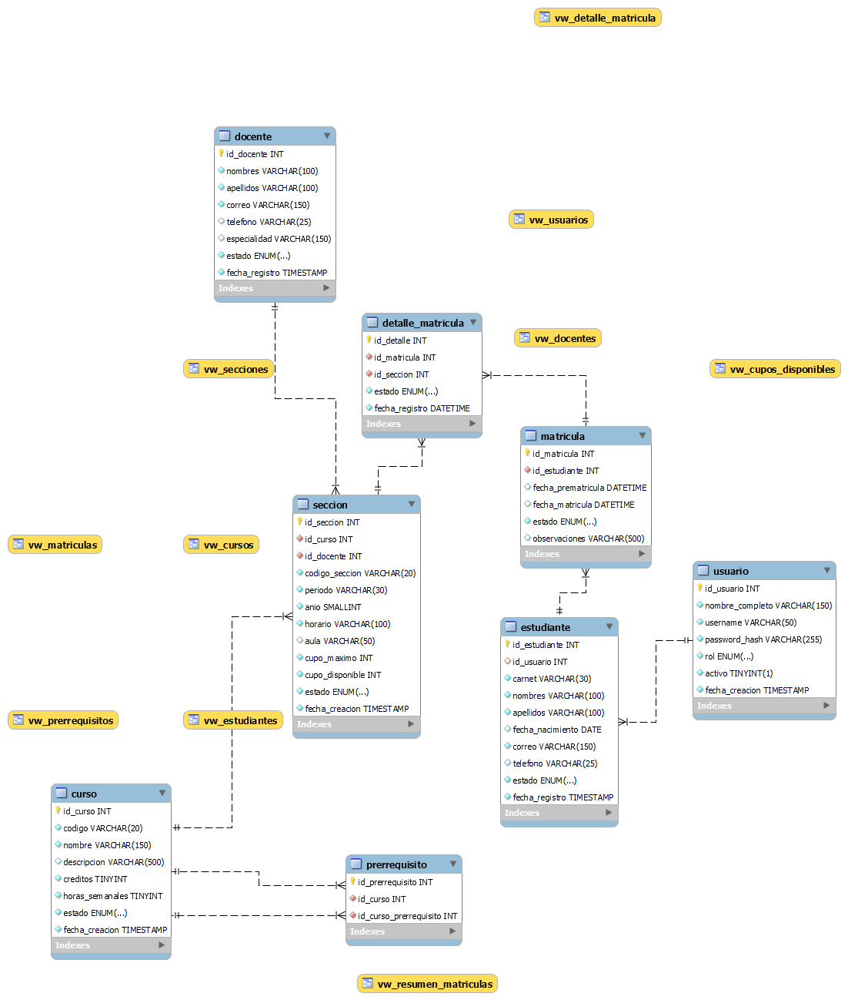

# EduControl — Sistema de Matriculación Académica

## Descripción

EduControl es una aplicación de escritorio desarrollada en JavaFX que permite gestionar el proceso de matriculación académica de estudiantes.

El sistema administra estudiantes, docentes, cursos, prerrequisitos, secciones y matrículas, utilizando una base de datos MySQL.

## Tecnologías utilizadas

- Java 21
- JavaFX 21
- Apache NetBeans
- MySQL 8.0
- JDBC
- Git y GitHub
- Apache Ant

## Arquitectura

El proyecto utiliza una arquitectura organizada por responsabilidades:

- **Model:** Representa las entidades del sistema.
- **DAO:** Define las operaciones de acceso a datos.
- **DAOImpl:** Implementa las operaciones utilizando procedimientos almacenados.
- **Controller:** Controla las vistas JavaFX.
- **View:** Contiene los archivos FXML.
- **SessionContext:** Administra la sesión y el rol del usuario.
- **Conexion:** Gestiona la conexión a MySQL mediante Singleton.

## Roles del sistema

### Coordinador académico
Administra los cursos y sus datos académicos.

### Estudiante
Consulta las secciones disponibles y realiza su prematrícula.

### Secretaría
Participa en la gestión administrativa y validación de matrículas, según las funciones implementadas.

## Requisitos previos

- JDK 21 instalado.
- JavaFX SDK 21 configurado.
- Apache NetBeans compatible con Java 21.
- MySQL Server 8.0 en funcionamiento.
- Controlador MySQL Connector/J disponible en las bibliotecas del proyecto.

## Instalación y ejecución

1. Clonar el repositorio:

   ```bash
   git clone https://github.com/ESTEBanano1994/EduControl_JuanInteriano.git
   ```

2. Abrir el proyecto en Apache NetBeans.

3. Crear la base de datos `educontrol` ejecutando los scripts SQL incluidos en la carpeta `database`, respetando su orden de ejecución.

4. Configurar la conexión a MySQL y proporcionar la contraseña mediante la variable de entorno `EDUCONTROL_DB_PASSWORD`.

5. Agregar las bibliotecas JavaFX y MySQL Connector/J que necesite el proyecto.

6. Configurar las opciones de ejecución de JavaFX:

   ```text
   --module-path "RUTA_DEL_JAVAFX_SDK/lib" --add-modules javafx.controls,javafx.fxml
   ```

7. Ejecutar **Clean and Build** en NetBeans.

8. Ejecutar el proyecto mediante **Run Project (F6)**.

## Base de datos

**Motor:** MySQL 8.0

**Nombre de la base de datos:** `educontrol`

**Tablas principales:**

- usuario
- estudiante
- docente
- curso
- prerrequisito
- seccion
- matricula
- detalle_matricula

La aplicación utiliza procedimientos almacenados para las operaciones de acceso a datos y la validación del proceso de prematrícula.

## Credenciales de desarrollo

La conexión utiliza el usuario MySQL configurado en la clase `Conexion`. La contraseña se proporciona mediante la variable de entorno `EDUCONTROL_DB_PASSWORD`.

No se deben publicar contraseñas privadas en el repositorio.

Las cuentas de prueba, si se incluyen en los scripts de datos iniciales, deben utilizarse únicamente en un entorno de desarrollo.

## Diagrama entidad-relación

El diagrama ER del sistema se encuentra en la carpeta `docs`, junto con la documentación de integración.


## Control de versiones

El proyecto utiliza GitFlow, con las ramas `main`, `develop` y ramas `feature/` para desarrollar cada fase.

## Autor

Juan Esteban Interiano Riera

Proyecto final de Programación.
